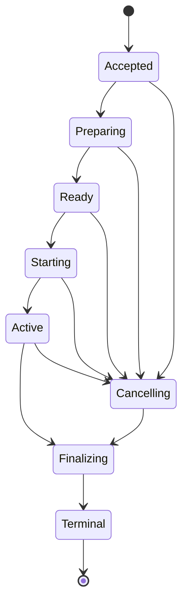

# remote-task-runner 仕様

仕様版 1.2 / 2026-11-10（1.1: 2026-11-09、1.0: 2026-11-06）/ 実装に向けた提案仕様

この文書は、`remote-task-runner` を日常の開発で使える状態まで一度に実装するための仕様である。未コミット変更、複数Macへの配置、導入・起動、ログ・成果物、キャンセル、切断・再起動からの復旧を、初回リリースの必須条件とする。実装工程は分けるが、これらが揃う前を実用版の完成とは扱わない。

会話で確定した要求と、この文書で具体化する設計を区別する。以下のコマンド、API、設定名、既定値は新設する仕様案であり、現行リポジトリに存在する機能を示すものではない。

1.1 での変更: 第22章（環境の整合）と第23章（設計判断と基準実装の更新）を追加し、受入条件 A42〜A44 を足した。

1.2 での変更: workerのattempt workspaceをfast-worktreeで作る・消す方針を22.5として加え、依存の準備の担当を第6章・第8章で整理した（`.fast-worktree.toml` を優先し、`[prepare]` は代替）。fast-worktreeを22.4の周辺toolに加えた。artifactの範囲を「同一run内の同じworkflow内」に改めた（第7章・第13章）。lib化後の基準版を task-traffic-controller 0.5.0、local-ci 0.9.0 に更新した（第16・17・21・23章）。基準プラットフォームにLinux（x86_64・arm64）を加え、Google Colab等の常駐しない一時workerと `workers forget` を定めた（第1・4・12・15章）。`.worktreeinclude` に一致するignoredファイルをsecret_filesと同じ経路で自動送付する（第6章・22.3）。受入条件 A45〜A49 を足した。worker の priority（配置の好み）を設定に加え、配置の比較値に補正量として入れた（第5章・A49）。

# 1. 製品の目的と確定事項

`remote-task-runner` は、手元のMacとLAN内の複数Macを使ってCIと開発用コマンドを実行する、単一コマンドの実行基盤とする。利用者は仕事を投入し、配置・待機・実行・回収をツールに任せる。

| 項目 | 契約 |
| - | - |
| 公開コマンド | `remote-task-runner` に統合する |
| 仕事の呼び名 | `homework` |
| 構成 | 親となるcoordinatorが1つ、workerが複数 |
| 親の計算資源 | 親自身もworkerとして参加する |
| 実行場所 | 通常、発注側は指定しない。能力・待ち時間・準備時間から親が選ぶ |
| 対象 | `local-ci` によるCIと、一般の非対話コマンド |
| 最初の実用版 | 未コミット入力、動的配置、導入・起動、回収、停止、復旧を含む |

基準プラットフォームはmacOS 14以降のarm64とx86_64、およびLinuxのx86_64とarm64とする（Linuxの追加は2026-11-10の決定）。親のcoordinatorもworkerも両OSで動く。Google Colabのような常駐しない環境は、Linux上の「一時worker」として扱う（第15章）。これは新しい製品の対応方針であり、現時点の動作確認済み範囲ではない。リリース時に対応OS・CPUで検証する。

分散するのは独立して実行できる仕事である。1つの通常プロセスが使うメモリを複数Macのメモリにまたがって確保する仕組みではない。1つの巨大な処理は、実行に必要な資源を持つMacへ配置するか、明示した分割契約によって複数のhomeworkにする。

# 2. 初回リリースの完成範囲

次をすべて必須とする。

1. `remote-task-runner ci` と `remote-task-runner exec -- <command>` が、親と子を同じ候補として扱う。
2. 変更中のソースを固定し、未コミット・未追跡・未pushの内容をリモートでも正しく実行できる。
3. CPU・メモリ・ローカルキュー・実行履歴・転送・setupを考慮して配置する。
4. 未配置の仕事を親に保持し、空いたworkerや途中参加したworkerへ動的に割り当てる。
5. 親からSSHでworkerを登録、導入、起動、停止、更新できる。
6. CLIを閉じても受理済みの仕事とログが失われず、再接続で追跡できる。
7. 切断・ACK消失・親やworker agentの再起動で二重実行を起こさない。
8. 未開始・実行中の仕事を取り消せる。停止確認前に停止済みと表示しない。
9. 必須成果物と終了結果を検証して回収でき、回収だけを再開できる。
10. 既存の `local-ci` と `task-traffic-controller` のCLI互換を維持し、同一ホストの資源予算を二重に作らない。共有scopeでの保証には、後述するtask-traffic-controller runtime更新を必要とする。
11. `needs` を保持したJob DAGと独立Shardを複数workerへ配置できる。長時間テストの自動shardingも初回実用版の対象とする。
12. 実際の2台以上のMacと障害注入で、後述の受入条件を満たす。
13. worker間のツール版・入力ファイルの差を検出し、自動で揃えられるものは揃え、揃えられないものは理由と手順を示す（第22章）。
14. Linux（x86_64・arm64）のworkerを、macOSと同じ契約で常駐・導入・更新できる。常駐しない一時worker（Google Colab等）を、親からSSH経由で使い、消滅を利用者が宣言できる（第15章）。
15. workerのattempt workspaceを、プロジェクトの `.fast-worktree.toml` と `.worktreeinclude` をそのまま使ってfast-worktreeで作り、消す（22.5）。

対象外は、複数親による自動フェイルオーバー、任意プロセスの途中状態の移送、電源OFFのMacの確実な遠隔起動、任意のGitHub Actions actionへの完全互換、共有メモリ型の分散処理とする。これらは今回の開発目的を定義する境界であり、上記の実用機能を後回しにする理由にはしない。

# 3. 責務と内部構成

| 層 | 担当 | 担当しないこと |
| - | - | - |
| remote-task-runner CLI | 投入、観察、キャンセル、worker管理 | workerの選択を利用者へ要求しない |
| remote-task-runner coordinator | durableなキュー、配置、attempt管理、集約、GitHub status | リモートプロセスの資源を親の測定値で代用しない |
| remote-task-runner worker agent | 受理、入力準備、ローカル実行管理、spool、再接続 | 分散先を独自に選び直さない |
| attempt supervisor | 1つのattemptの寿命、lease、step・サービスの管理 | SSHセッションの寿命に従属しない |
| command supervisor | 1つの重いcommandのadmission、起動、計測、停止 | worker全体のsignal handlerを共有しない |
| local-ci-core | workflow解析、Job DAG、実行可能Task／Shardへの分割、CI実行・結果 | ネットワーク配置を所有しない |
| task-traffic-controller-core | 1ホスト内の資源計画、キュー、開始判定、見積もり、計測 | ネットワークや分散リーダーを管理しない |

`task-traffic-controller` に分散システム全体を入れない。ホスト内の資源制御を再利用可能にし、その情報を `remote-task-runner` が配置判断に使う。

配布物は原則として1つの `remote-task-runner` バイナリとする。通常利用で `local-ci` や `task-traffic-controller` の別インストールを要求しない。既存リポジトリから `local-ci-core` と `task-traffic-controller-core` を抽出し、既存CLIもそのcoreを使う薄いadapterとして維持する。依存version・protocol・cache schemaは固定し、配布物に元のライセンス表記を含める。

workerには待受プロセスを置く。ただしLANへ独自の未認証TCPポートを開ける構成を既定にはしない。親がSSH接続を張り、`remote-task-runner worker --stdio` をUnix socketへのbridgeとして起動する。agentとsupervisorはSSHから独立して動く。親のlocal workerも同じ実行経路を使い、通信部分だけUnix socket直結とする。

attempt supervisorは、attemptごとに同じ `remote-task-runner` バイナリを別プロセスとして起動したものとする（第23章）。

# 4. 利用者が使うコマンド

## 初回セットアップ

```sh
remote-task-runner init
remote-task-runner workers add mini-a --ssh ci@mini-a.local --install
remote-task-runner workers add mini-b --ssh ci@mini-b.local --install
remote-task-runner doctor
```

`init` は親のcoordinatorとlocal workerを構成する。`workers add --install` はSSH接続、互換バイナリ転送、service登録、起動、能力検査を実施する。再実行は冪等とし、途中失敗を再開できる。SSHのRemote Loginと認証が利用可能であることは前提とする。OSの権限やライセンス同意が必要な環境導入は、必要な操作と検出した不足を明示する。

## 日常の利用

```sh
remote-task-runner ci
remote-task-runner ci plan
remote-task-runner ci --snapshot commit --ref HEAD

remote-task-runner exec -- pnpm test
remote-task-runner submit -- cargo test

remote-task-runner ls
remote-task-runner show <run-or-homework-id>
remote-task-runner logs <id> --follow
remote-task-runner wait <id>
remote-task-runner cancel <id>
remote-task-runner retry <id>
remote-task-runner outputs <id> --dir ./remote-task-runner-results
```

`ci` はCI runを作り、その中のJob／Task／Shardをhomeworkにする。`exec` は原則1つのhomeworkを作り、結果まで待つ。`submit` は非同期投入で、親が入力snapshotと実行仕様を永続受理した後にIDを返す。workerでの受理や実行開始までを保証する応答ではない。

通常のCLI終了・ターミナル切断はキャンセルを意味しない。foregroundの `exec`／`ci` に対するCtrl-Cは明示的なキャンセル要求として扱い、停止確認を待つ。接続できなければ `cancel_requested / unknown` と表示してIDを残す。`retry` は停止または終了を確認したterminal attemptに対して、新しいattemptを作る。同じrunのretryは元のsource snapshotを使う。現在のファイルで試すときは新しいrunを投入する。

機械向けには各操作へ `--json` を用意し、`schema_version`、ID、状態、error codeを返す。進捗はstderr、構造化結果はstdoutとする。`exec`／`wait` は正常終了なら0、コマンド失敗なら可能な範囲で元のexit codeを返す。signal、入力不備、通信未確定、成果物回収失敗はJSON上で区別する。CLIプロセスの終了コードだけをjobの確定状態と見なさない。

## workerの管理

```sh
remote-task-runner workers
remote-task-runner workers start mini-a
remote-task-runner workers drain mini-a
remote-task-runner workers resume mini-a
remote-task-runner workers stop mini-a
remote-task-runner workers upgrade mini-a
remote-task-runner workers diff mini-a
remote-task-runner workers sync mini-a
remote-task-runner workers forget colab-1
remote-task-runner estimate --json -- pnpm test
```

`drain` は新規配置を止め、受理済みの仕事は完了させる。通常の `stop` はdrainして終了を待ってから停止する。即時停止は `stop --cancel-running` で明示し、停止確認まで追跡する。到達不能なら停止済みにはしない。`diff`／`sync` は第22章で定める。`forget` は、到達できなくなった一時workerの消滅を利用者が宣言する操作で、第15章で定める。

表示は最低限、worker、能力、接続状態、running／waiting、資源予算、予測の品質を含む。homeworkには担当worker、実行段階、ローカル待ち時間、見込み完了時間、source ID、attempt IDを表示する。未知の時間を0秒と表示しない。

# 5. 設定と能力の照合

マシン・SSH・serviceの情報はユーザー設定へ置き、プロジェクトには必要能力と実行契約を置く。

ユーザー設定例：`~/.config/remote-task-runner/config.toml`

```toml
schema_version = 1

[coordinator]
local_worker = true
local_worker_priority = -1   # 手元のMacは後回し（既定0、-100〜100、大きいほど優先）
heartbeat_seconds = 5
lease_seconds = 60

[scheduler]
strategy = "earliest_finish"
forecast_ttl_ms = 2000
prefetch_per_worker = 1
priority_step_seconds = 60   # priority 1段 = 60秒分の補正（既定60、0〜3600）

[defaults]               # プロジェクトが上書きできる既定値（最も低い設定層）
timeout_seconds = 3600
toolchain_match = "exact"

[[workers]]
id = "mini-a"
ssh = "ci@mini-a.local"
service_mode = "user"
priority = 10            # 最優先のworker
labels = ["macos", "arm64", "node"]

[[workers]]
id = "mini-b"
ssh = "ci@mini-b.local"
service_mode = "system-user"
labels = ["macos", "x86_64", "node", "docker"]

[[workers]]
id = "colab-1"
ssh = "colab-1"          # 利用者が用意したトンネルを指すssh設定の別名
ephemeral = true         # 常駐しない一時worker（第15章）
priority = 0
labels = ["linux", "x86_64", "node"]
```

プロジェクト設定例：`.remote-task-runner.toml`

```toml
schema_version = 1

[source]
mode = "worktree"
include = []
exclude = ["remote-task-runner-results/**"]
secret_files = [".env.test", "packages/*/.env.test"]

[execution]
profile = "web-dev"
requires = ["macos", "node"]
pass_env = ["CI"]
timeout_seconds = 3600

[toolchain]
match = "exact"

[ci]
workflows_dirs = [".github/workflows"]
no_cache = ["ci.yml", "e2e.yml:browser"]   # 結果を再利用しないworkflow、またはjob
status_context = "local-ci"
unsupported = "error"

[[outputs]]
name = "test-results"
paths = ["test-results/**", "coverage/**"]
required = false
when = "always"
```

設定の優先順位は、明示CLI引数、プロジェクト設定、ユーザー設定、既定値とする。旧 `.local-ci.toml` は対応する項目のfallbackとして読む。両方で矛盾する設定は出所を表示し、黙って片方を無視しない。未知の設定名はerrorにする（`secret_files = [{ glob = ".env", requird = true }]` のように表の内側の綴り誤りも、キー名と位置を示してerrorにする）。

ユーザー設定の `[defaults]`（`timeout_seconds`、`toolchain_match`）は、プロジェクトが書かなかったときの値で、優先順位は「明示CLI引数、プロジェクト設定 `[execution] timeout_seconds` と `[toolchain] match`、`[defaults]`、既定値」とする。ユーザー設定が決めてよいのはこの2項目だけで、`requires`・`secret_files`・`outputs` 等のプロジェクト固有の契約は置けない。

`.local-ci.toml`（local-ci 0.9）の項目は次のとおり扱う。list項目は、順序と重複を無視した集合として比べて矛盾を判定する。

| `.local-ci.toml` | 扱い |
|---|---|
| `workflows-dirs` | `[ci] workflows_dirs` のfallbackとして読む |
| `[source] include` / `exclude` / `secret_files` | 同名の `[source]` 項目のfallbackとして読む |
| `no-cache` | `[ci] no_cache` のfallbackとして読む。対象は `ci.yml`（workflow）または `ci.yml:e2e`（job）。実際の効果は第8章 |
| `link-node-modules` | 対応しない。値があるときだけ `ci plan` と `doctor` がnoticeとして表示する（依存の準備はfast-worktreeの `[[clone]]` が担う） |
| `[setup] ignore-env` | 同上 |

liveness設定は、heartbeat < lease、stale ≥ heartbeat × 2、lease > stale（stale < lease）を検査し、破れる組み合わせはerrorにする。値は0を許さない。一時worker（`ephemeral = true`）はserviceを持たないため、`service_mode` を書くとerrorにする。

workerが申告する能力には、OS・arch・実行user・有効なprofile、tool version、Docker実行可否、利用可能disk、資源予算、protocol、feature flagsを含める。profileは実行PATH、shell、必要tool、許可するenv・secret参照、cache条件を定義し、内容のdigestで識別する。ラベルだけで実際のtool検査を代用しない。

配置前に能力を絞る。候補がないときは `blocked: no_compatible_worker` とし、不足能力を表示する。同じリポジトリであってもarm64用の依存cacheをx86_64で使わない。Rosetta等の別実行環境は別profileとする。自動導入で解消できる不足は、第22章の手順で導入してから候補に含める。

# 6. 入力snapshotと作業ディレクトリ

## 既定は現在の作業内容

`remote-task-runner ci` と `remote-task-runner exec` は、既定で呼び出し時のworktreeを固定する。commit済みの内容だけを実行するときは `--snapshot commit --ref <ref>` を明示する。既存の単独 `local-ci run` の既定動作は変更しない。

worktree snapshotには、追跡済みファイルのstaged／unstaged変更、削除、実行bit、binary、symlink、gitignore対象外の未追跡ファイルを含める。tracked fileはignoreに一致しても収集し、ignoredな未追跡ファイルは明示したincludeだけを追加する。`secret_files` と `.worktreeinclude` に一致するignoredファイルはsnapshotに含めず、第22章の別経路で扱う。コピー対象の拡張は `ci plan`／dry-runで確認できる。原本のworktree、index、branch、refsを書き換えない。

収集と検証の手順は次とする。

1. HEAD、index tree、論理branch、base・merge-base、収集対象一覧を記録する。
2. 内容をprivateなobject storeへ取り込み、path・mode・size・hashのmanifestを作る。
3. 内容とGit metadataを再検証し、収集中の変更を検出したら最大3回まで再試行する。
4. 安定した内容が得られた場合だけ、manifestをatomicに公開して `source_id` を確定する。
5. 確定できなければ `SOURCE_BUSY` とし、workerへdispatchしない。

これは検証付きのcopyによる固定であり、編集が並行するファイルシステム全体の厳密な同時点snapshotを保証するものではない。1つのrunでcaptureするのは1回とし、途中参加worker、再配置、再接続、retryも同じ `source_id` を使う。

## Gitの実行文脈

`SourceManifest` は少なくとも次を保持する。

| フィールド | 意味 |
| - | - |
| source_id / manifest_digest | 入力内容を固定するidentity |
| repository_id | ホストの絶対pathに依存しないrepo identity |
| source_kind | worktree、commit、directory |
| original_head / index_tree / worktree_tree | 元のGit状態と固定した内容 |
| execution_commit | CI用に作るsynthetic commit、または指定commit |
| base / merge_base / branch | 差分・条件式のための論理文脈 |
| cwd_relative | repo rootからの相対作業path |
| object_manifest | 未pushのcommitを含む必要Git objects |
| submodules / lfs | 固定したrevisionと必要payload |
| secret_files | 第22章のsecret bundleのHMAC digestとpath一覧（`.worktreeinclude` 由来を含む。内容は含めない） |

generic execでは可能な範囲でHEAD・index・worktreeの区別を再現し、`git diff` と `git diff --cached` が元の変更を表せるようにする。CIでは同じcaptureからsynthetic commit viewを作り、その内容でworkflow・config・changed filesを解釈する。元HEADやbranchの論理文脈は別フィールドで渡す。

必要なGit objectsとbase履歴をbundle等で転送する。workerが移動中のorigin branchをfetchして入力を決め直す方式は使わない。未pushのHEADも実行できる。submoduleとGit LFSは、固定revisionと実体をmanifestに含める。dirty submoduleは再帰capture、LFS payload不足は実行前errorとする。

worktreeのraw bytesとGitのcanonical blobを区別する。LFS、clean／smudge filter、改行変換を経た実際のmaterialized fileがmanifestのhashと一致することを検証し、capture済み内容へfilterを重複適用しない。pathはlosslessに扱い、shell文字列連結やlossyな文字コード変換で収集対象を変えない。

symlinkはlink値を保持し、取り込み時にrepo外を自動追跡しない。repo外入力が必要なら入力として宣言して相対mountへ配置する。FIFO・socket・device等の非通常ファイルは明示errorにする。source／artifactの展開では絶対path、`..`、symlink traversalによる管理領域外への書込みを拒否する。

## workerでの準備

workerはrepoごとのcanonicalなlocal cloneと、attemptごとの隔離workspaceを持つ。親の絶対cwd、`.git` のworktree参照、準備済み `node_modules`、venv、絶対symlinkをそのまま移送しない。依存はworker自身のprofileで準備する。

Git外のgeneric execにはdirectory snapshotを提供する。sourceが不要な管理コマンドも明示できるが、通常実行から黙って入力を省略しない。元の手元ディレクトリを直接更新する用途には `exec --in-place` を用意し、親local workerだけを適合候補とする。通常の分散実行で、生成物を元worktreeへ自動で上書きしない。

`in-place` は明示的な別workspace modeである。記録するsnapshotは比較用baselineで、実行入力の不変性は保証しない。remote配置、結果cache、既定の自動retryを無効にし、表示・結果でもsnapshot実行と区別する。

依存の準備は、プロジェクトの `.fast-worktree.toml` の `[[clone]]`（と `post_add`）が担う。attempt workspaceをfast-worktreeで作る方針と、`.worktreeinclude` の扱いは22.5で定める。第8章のSetupRecipeとtemplateは、workflowのsetup stepの再利用に限る。`.fast-worktree.toml` を持たないプロジェクトでは、第8章の `[prepare]` が代わりを務める。両方がある場合は `.fast-worktree.toml` を優先し、`ci plan` が準備の出所（`fast-worktree` / `[prepare]` / workflowのsetup step）を表示する。

# 7. CI計画と分散単位

## FrozenPlan

親は入力snapshotに対して一度だけ計画を作り、`FrozenPlan` として固定する。workflow選択、無効化の判断、config、差分、branch、base、job filter、Job DAG、Task／Shard、依存、実行条件を含める。workerはこの計画を実行し、同じ引数で `local-ci run` を再度解釈し直さない。

実行中のneeds outputによるdynamic matrixや条件式は、依存出力が得られた段階で評価する。提出時点に全variantの値が分かっているとは扱わない。展開結果を永続eventとして固定し、再接続で別の展開を行わない。

## Job DAG・Task／Shardと配置の境界

現行local-ciのUnitは、needs関係や実行環境を共有するJobをまとめている。新しいplannerはUnitを唯一の配置単位とはせず、Workflow → Job DAG → Task／Shard の階層を作る。`needs` は同一ホストへの固定ではなく、先行Jobの結果・output・artifact確定を要求する依存辺とする。Job間のworkspace共有はGitHub Actionsの通常の独立Job意味論に従い、暗黙のファイル共有を仮定しない。必要なデータは明示artifactまたは契約化したimmutable inputとして渡す。中間artifactの範囲は、同一run内の同じworkflow内に限る（第13章）。worker側で `-j` を再解釈して先行Jobを重複起動しない。

**未配置のJob／Shardは動的に配置できる。配置された実行セッション（workspace・service・step状態を持つ単位）は開始後、同じhostに固定する。** `needs` の先行Jobが別hostで完了しても、結果と必要artifactが親で確定した時点で後続Jobを別workerへ配置できる。同一Jobの任意の連続stepを、workspaceの状態転送なしで別hostへ移動しない。受理済みだが未開始のattemptを再配置する場合も、元workerのretireと停止確認を要する。

run開始時に全Unitをworkerへ押し込まない。親に未配置backlogを残し、workerごとの先行受理枠を制限する。既定の `prefetch_per_worker = 1` は、実行セッション開始前の先行homeworkを1件に制限する値であり、実行中step数やCPU budgetとは別である。実際のstep並列数はtask-traffic-controllerのadmissionとCIのconcurrency規則に従う。

### 分割モデルと決定規則

`FrozenPlan` は `JobGraph`（workflowのJobとneeds辺）と `ExecutionTask`（配置可能な実行セッション）、`ShardGroup`（分割元Jobと集約契約）を持つ。各TaskのID、実行条件、必要input／artifact、workspace policy、サービス、資源見積、retry policy、出力検証を固定する。Jobの内部stepは原則同一Taskに置く。runner adapterが入出力の独立性を証明できるテスト部分だけ、元Jobを複数Taskへ展開できる。

分割可能性の判断は「runnerがテスト集合を列挙できる」「各Shardで正しく対象testを指定できる」「Shard間で共有状態を競合更新しない」「必要fixture／DB／serviceを独立提供できる」「集約結果が元のJob判定と一致する」の全条件とする。単にscript名に `test` が含まれるだけでは分割しない。splitできない理由は `remote-task-runner ci plan` に出す。

### 自動shardingの実装契約

初回版はJest・Vitest・Playwright・Cypress・`cargo test` のうち、対象プロジェクトで実際に使うrunnerをadapterで認識する。adapterは `discover`、`partition`、`invoke`、`collect`、`merge` を備え、runnerのversion・設定・filter／tag／skip条件を保持する。サポート不能な機能を推測で分割せず、安全な単一Task実行へfallbackする。選択されなかったtestや失敗したtest discoveryも明示する。

partitionは各テストファイル（またはrunnerの安全な分割単位）の履歴時間を使い、予測完了時間の長いものを優先して、worker性能補正後の各Shardの推定負荷が均等になるよう割り当てる。初回実行や履歴不足時は安定した名称順と決定的hashによるfallbackを使う。同じsnapshot、runner version、shard plan、履歴snapshotなら同じ分割になる。極端に小さいtaskはsetup・転送の固定費を考慮してまとめる。shard数はworkerの実効容量、CI全体の残りDAG、並列上限に応じて決定する。

同一テストが異なるShardに重複しないこと、対象全件を一度だけカバーすることをmanifestの集合検証で保証する。テストの動的生成などで事前列挙が不完全なrunnerではrunner固有の安全なshard機能だけを使う。DBを共有するE2Eはdatabase／schema／port／containerをShardごとに隔離できないなら分割禁止とする。

### 結果集約・失敗・再試行

Shardの結果は `job_id / shard_id / test_identity` で集約し、assertion数、failed／skipped test、coverage、JUnit等のartifactを重複・欠落検証する。coverage mergeはrunner対応方式だけで行い、単純な数値加算で代替しない。元Jobの `needs` outputと後続の開始判定は、ShardGroup全体が終了し集約が確定した後に公開する。fail-fastは親が残りShardへのcancel要求を発行し、停止確認と中途結果を残す。retryは失敗Shardを同じsnapshotで新attemptとして実行し、通過済みShardの検証済み結果を保持できる。ただしrunner固有の非冪等テストでは明示的なretry許可が必要。

単一Jobのステップ間で生成された書込み可能workspace、常駐service、プロセス内状態を自動移送することはしない。複数Taskへ切り離す境界は、immutable artifactと明示依存だけで再現できる位置に限定する。

## matrix・自動テストsharding・明示shard

独立workspaceと明示input／outputで実行できるmatrix variantやtest shardは、初回実用版から複数workerへ分散できるようにする。共有workspaceの任意のfile依存を自動的に推論して切断する仕様にはしない。

分割を許可する条件は、plannerが独立性を扱える構造であること、またはプロジェクト設定で独立workspace・入力・出力・集約方法を宣言していることとする。前段の生成物が必要な場合はimmutable artifactとして確定してからvariantへ配る。後段は必要なvariantのterminal結果とartifactが揃うまで開始しない。

親が全workerを通した `max-parallel`、`fail-fast`、variant ID、結果集約を管理する。どのvariantのoutputを後段へ渡すか曖昧なら、明示した集約規則を必須とする。既存の共有workspace前提のUnitは維持する。

`remote-task-runner ci plan` は、分散可能なhomework数、依存関係、並列幅、分割できない理由を表示する。実利用するCIが1つの不可分Unitに閉じている場合、そのまま「複数Mac対応完了」と判断せず、独立shardの契約を設計する。

# 8. setupとcache

各配置可能Task／Shardは、他hostのsetup成功に暗黙依存せず、自分の準備を完結できる計画を持つ。同一Jobの分割Shard間で必要な入力はimmutableなprepare receipt・artifactとして渡し、共有の書込み可能workspaceを仮定しない。

現行の全体hoist後の `execute=false` や、別jobがsetup所有者であるという参照を、そのまま分散用DTOへ保存しない。元stepを保持したUnitから `SetupRecipe` を導出し、実際に準備されたstepの対応だけを `PreparedTemplate` receiptに記録する。workerはそのreceiptにあるstepだけをskipする。

template keyには、source digest、順序付きsetup recipe、working directory、解決済みshell、workflow／job／stepを合成した実効env、toolchain・OS・arch・profile、cache schema、reuse scope、freshness policyを含める。scopeは `run / persistent` を区別し、run scopeではrun IDもkeyへ含める。コマンド文字列だけが同じでも準備の同一性を認めない。

同じtemplateの生成はworker内でsingleflightにし、複数Unitで待てる。builderは独立した `builder_id` とdurableなconsumer参照集合を持つ。1つのUnitのcancelや再配置で、他Unitが必要とするbuilderを止めない。最後の有効参照がなくなった場合にだけbuilder停止を判断する。setupも重いcommandとしてtask-traffic-controllerに登録し、builder IDに対するbudget chargeとforecast上の需要は1つだけ保持する。

完成templateはimmutableとし、Unitごとにcopyまたはwrite-isolatedなcloneを作る。書込み可能なhardlinkの共有は禁止する。新しいrequirementsを既存templateへ追加実行して上書きせず、別keyで構築する。forecastでは共有builderの負荷を1回だけ数え、各Unitの依存として参照する。

cacheはworker内を基本とし、別hostの準備済み依存を無条件には流用しない。source、plan、profile、OS・arch、tool version、env参照version等が一致することを確認する。secretが結果へ影響する場合、値をcache keyに保存せずsecret version等で識別し、それができなければcache対象から除外する。

`--no-cache` は他runのprepared templateと計算結果のreuseを止める。プロジェクト設定 `[ci] no_cache`（`.local-ci.toml` の `no-cache` と同じ書式）に挙げたworkflowまたはjobには、`--no-cache` を付けた場合と同じ扱いを常に適用する。同じrunで必要な同一recipeのsingleflight共有は維持する。検証済みのimmutable source objectsは転送最適化として再利用できる。worker追加直後のcold setupも配置コストに含め、cache hitを前提にETAを表示しない。

runtimeのneeds、matrix、service、step outputに依存する準備は、その実行位置に残す。`GITHUB_ENV` 等の副作用をcapture・replayできないstepもhoistしない。venv等の絶対pathに依存する環境を別pathへ単純copyせず、安全な共有ができなければUnit専用に準備する。再利用可能性を確認できないsetupはrun内の再利用に限定する。最適化できないことを理由に必要なstepを省略しない。

本章のSetupRecipeとtemplateが扱うのは、workflowのsetup stepの再利用である。依存そのもの（`node_modules`、`.dart_tool` 等）の準備は、22.5のとおりfast-worktreeの `[[clone]]`（と `post_add`）が担い、worker用の準備設定を別に持たない。

generic execの依存準備もプロジェクトに宣言できる。`.fast-worktree.toml` を持たないプロジェクトでは、例えば `[prepare]` の `commands = [["corepack", "pnpm", "install", "--frozen-lockfile"]]` を、同じsetup・admission・cacheの経路で実行する。`.fast-worktree.toml` があるプロジェクトでは `[prepare]` より `.fast-worktree.toml` を優先し、`ci plan` に出所を表示する。`init` は検出したlockfileに応じた設定案を生成できる。`exec pnpm test` が別Macの偶然の `node_modules` に依存する構成にはしない。

# 9. 配置と待ち時間の見積もり

## 配置の手順

coordinator内の1つのscheduler actorが、配置のcommitを直列化する。複数利用者からの投入やworkerへの見積照会は並行してよい。

1. 親のready queueから対象homeworkを選ぶ。通常優先度では投入順と待機時間を考慮し、依存未解決の仕事で独立した後続を塞がない。
2. OS・arch・profile・tool・必要disk・明示resource要件で候補を絞る。
3. 各workerへ、現在のキューと候補workloadを含むforecastを照会する。
4. source差分転送、setup（第22章のtoolchain導入を含む）、実行、成果物回収を含む予測完了時間で比較する。
5. workerとattemptを選び、親DBに配置と未ACKの需要を同じtransactionで記録する。
6. transactionを閉じてからworkerへ送信する。次の配置はこの未ACK需要も考慮する。
7. workerの受理・登録・終了に応じて仮需要を実状態へ置き換える。

最短の予測完了時間を基本とし、同程度なら待機の少なさ、cache状態、転送量、既存affinity、stable worker IDで決める。これは推定に基づく配置であり、全体の最適解や完了時刻の保証ではない。

利用者は設定でworkerに好みを付けられる（`[[workers]]` の `priority`、親のlocal workerは `[coordinator] local_worker_priority`。整数、既定0、大きいほど優先、範囲は -100〜100）。比較値は次のとおりとする。

```
比較値 = 予測完了時間 + (候補中の最大priority − そのworkerのpriority) × priority_step_seconds
```

`priority_step_seconds` は `[scheduler]` の設定（整数秒、既定60、0〜3600）。比較値が最小のworkerを選び、同程度の判定と同点規則の先頭にpriorityを置く（priorityが高い方、次に上の既存の規則）。手順2の能力条件（requires・labels）による候補の絞り込みは従来どおり強制で、priorityは候補の中での好みに限る。全workerのpriorityが同じなら補正量は0になり、従来と同じ配置になる。ephemeral workerもpriorityを持てる。

例：`local_worker_priority = -1`、他のworkerが0なら、手元は60秒遅いものとして比べられ、他のworkerが60秒以上遅れない限りそちらへ配置される。手元を実質使わないなら大きな差（例：-50）を付ける。配置理由の表示には、priorityによる補正量（worker別の秒数）を含める。

workerはactive homework数と未開始prefetch数の両方を制限する。既定は `max_active_homework = 2`、`prefetch_per_worker = 1` とし、設定で調整できる。resource待ちのactive homeworkもactive枠を使う。セッションだけを大量に開始して親のbacklogを消費する実装を避ける。step単位のCPU・メモリ制御は別途task-traffic-controllerが行う。

## 必要なのは仕事ごとの予測

「このMacは平均何秒待つか」という値だけでは配置できない。対象の資源要求、先行キュー、準備が終わる時刻、後続step、並列上限によって変わるため、**このworkloadをこのworkerへ追加した場合の予測**を求める。

単一commandの概念式は次とする。

```text
開始まで = 準備完了まで + 準備完了時点からの資源待ち
完了まで = 開始まで + 実行時間 + 必須出力の回収時間
```

例えば、転送に10秒、現在のキューが30秒で解消し、実行に20秒かかるなら、回収を除いた完了予測は50秒である。10 + 30 + 20の60秒にはしない。転送中にも既存のキューが進む。

setupがCPUを使うcommandなら、単なる準備遅延へ隠さず資源を消費するnodeとして扱う。CI全体はDAGをsimulateし、並列stepの時間を単純合計しない。Unitの実測wall timeには内部の資源待ちが含まれるため、それを実行時間として使ってさらに待ち時間を足さない（local-ci v0.7.0以降は待ち時間を別に記録するので、待ちを除いた実行時間を使う。第23章）。

## WorkloadPlan

task-traffic-controller-coreへ渡す計画はCI非依存の構造とする。

| 要素 | 内容 |
| - | - |
| command node | command identity、予測weight／RSS／runtime、優先度 |
| dependency | 他node完了が開始条件となる関係 |
| external delay | 転送等、admission外の準備 |
| ready time | 現在から登録可能になるまでの相対時間 |
| concurrency | 実executorと同じ登録中・待機中・実行中の制約 |
| correlation | attempt、node、実ledger entryの対応 |
| shared dependency | 複数Unitが待つsetup builder等 |

未来のnodeはreadyになった時点で仮想キューへ入れる。全stepを最初からwaitingとして予約しない。ready順、FIFO、優先度、backfill、資源規則は実行時と一致させる。runtime条件やdynamic matrixで未確定の部分はunknownとして返す。

## 需要の二重計上と取りこぼしを防ぐ

forecastには、実ledger、workerが受理した未登録workload、親が送信中の未ACK workを含める。`attempt_id / node_id` を使い、実ledgerへ登録されたnodeは仮需要を置き換える。受理から登録への隙間で消えたり、実・仮の両方に数えたりしてはいけない。

workerはcoverageとsnapshot digestを返す。coverageは `attempt_id / plan_digest / expansion_seq / node_id` で範囲を特定し、dynamic matrixの追加nodeを、古いattempt単位の応答だけで考慮済みとしない。親は合成済みforecastに含まれるnodeをoverlayへ再追加しない。shared setup builderも1回だけ数える。

登録ACKだけで仮需要を消さず、今回のforecastに使う実ledger snapshotに同じnodeが存在するときだけ実需要へ置き換える。terminal確認済みnodeは除去する。別storeの読取り順序によって、実ledgerにもoverlayにも需要がないsnapshotを作らない。

forecastは読み取り専用とし、全workerへ100回照会してもqueue entry・lease・jobが増えない。snapshotは予約券ではなく、実行時は最新状態をlock下で再確認する。

## 不確実な予測

履歴なし、RSS不明、実行時間超過、live memory guard、古いsample、toolchain変更は予測品質へ反映する。未知を0秒・0byte・確実に空きと解釈しない。

APIは `measured / fallback / unknown` の出所、履歴件数、条件付き予測か、現在の待機理由を返す。運用開始直後も配置を止めないよう、設定されたfallbackと現在のqueue chargeによる順位付けを提供する。その内部用ranking値を、測定済みETAとして表示しない。未来の外部CPU・メモリ負荷の解消時刻は保証しない。

見積のTTLは既定2秒。期限切れ、worker boot／agent epoch／policy変更で見積を更新する。長い準備の終了後にも実際のadmissionを再確認する。

# 10. 永続状態と実行単位

## 主なidentity

| ID | 用途 |
| - | - |
| cluster_id / coordinator_id | 1つの親と配下のworkerの関係 |
| coordinator_epoch | 親の再起動後に古い制御を拒否する世代 |
| worker_id / worker_boot_id | workerのidentityとOS bootの区別 |
| agent_epoch | agent再起動を区別し、古いforecastを失効 |
| run_id | 1回のCIまたはcommand投入 |
| homework_id | 配置可能な論理的な仕事 |
| attempt_id / generation | 1回の実行試行と世代 |
| node_id | setup・step等の実行node |
| request_id / payload_hash | 冪等な要求と同一内容の確認 |

親と各workerは、それぞれローカルdiskのSQLiteを正本とする。WALを使用し、受理・配置・terminal確定等の重要transactionは永続commit後に応答する。LAN共有directory上のSQLiteや、task-traffic-controller ledgerを分散DBとして使用しない。

同じhomeworkに非terminalの実行attemptを複数持たない。新attemptは旧attemptのterminal／retiredが確認されてから作る。coordinator epochで古い制御要求を拒否するが、世代を増やしただけで古いプロセスが停止したとは扱わない。結果はattempt ID、generation、payload hashで採否を決める。再起動後にadoptした同じattemptの永続結果は、生成時のcoordinator epochが古くても回収する。

## 状態



terminal outcomeは `succeeded / failed / cancelled / timed_out / interrupted` を区別する。各段階の準備失敗・起動失敗等もfinalizingを通して確定する。stepの `waiting_resources / running` はattemptの内側に置く。CIではactiveの途中にも資源待ちが起こる。

通信の観測状態 `known / reconciling / unknown` は実行状態と別に保持する。切断は失敗でも未実行でもない。workerで計算が終了しても、親が必須出力を取得中ならrunは `collecting` と表示する。

## 受理の段階

| receipt | 保証 |
| - | - |
| coordinator accepted | 親に入力snapshotと実行仕様が永続保存された |
| worker accepted | workerが同じattempt・同じ内容を永続保存した |
| command registered | supervisorがlocal leaseを保持し、実ledgerへの登録が確認できた |
| running | 対象commandの実行開始が確認できた |
| terminal | 終了内容と停止・cleanupの結果が永続確定した |
| collected | 必須結果・成果物が親で検証、永続保存された |

1秒以内に完了する仕事でも、registeredの観測を待ち損ねたことを理由にlost扱いしない。永続eventとterminalを照会できるようにする。

# 11. 通信プロトコルと二重実行の防止

SSH上でversion付きの長さprefix JSON frameを使う。stdoutはprotocol専用、診断はstderrへ出す。大きなsource・artifactはchunk転送し、digestとoffsetで中断再開する。ログ転送がcontrol・heartbeatを塞がないよう、別streamまたは優先制御を実装する。

必要な操作は `hello`、`inspect`、`forecast`、`submit_attempt`、`get_attempt`、`list_attempts`、`renew_lease`、`cancel_attempt`、`retire_attempt`、`watch_events`、`read_log`、`get_result`、`ack_collected`、blobの転送・検証、secret bundleの転送（第22章）、環境差分の取得と導入（`env_report`・`env_sync`）とする。

`hello` でprotocol version、feature、worker identity、profile、epochを確認する。互換性のないworkerにはdispatchしない。要求は固定バイナリへ構造化データで渡し、利用者のargvやpathをSSHのshell文字列へ直接連結しない。

## 冪等性

同じ `attempt_id + payload_hash` のsubmit再送は、既存状態を返す。異なるpayloadならconflictとする。workerはacceptedをcommitする前にuser commandを起動しない。ACKを返す前後のcrashを想定し、親は同じattemptを同じworkerへ照会・再送する。

各command nodeには唯一のsupervisorによる実行claimと排他lockを持たせ、spawn前にlaunch intentを永続化する。setup builderにも同じ規則を適用する。starting状態からの復旧はprocess identityと照合し、起動の有無が不明なら再spawnしない。

**ACKが失われたことを理由に、別workerで同じ仕事を始めない。** 一時的な `not_found` だけでも再配置の証拠として不足する。遅れたsubmitが後から到着する可能性があるため、元workerにretire tombstoneを永続化し、未開始または停止済みを確認してから新attemptを作る。

元workerがofflineで確認できなければunknownのまま保持する。leaseが切れたはずだという時間推測だけで、別workerへ自動再投入しない。これにより、障害時に可用性より重複防止を優先する箇所を明確にする。

retire・重複排除の最小記録はclusterの寿命中保持する。大量のログ・成果物をGCしても、古いsubmitを新規実行する状態に戻さない。完全消去・再登録は新しいworker identityとして扱い、旧identityのunknown attemptを自動的に再投入しない。

# 12. lease、停止、再接続、再起動

## 生存確認と実行lease

既定値はheartbeat 5秒、接続stale判定15秒、実行lease 60秒、TERM後の停止猶予10秒とする。これらは設定可能とし、相互の矛盾を検査する。

親がworkerの状態を受け取り、workerは親から制御・lease更新を受ける。短い切断では有効leaseの範囲で実行を継続する。期限が切れた場合は新しいuser commandを開始せず、実行中commandと所有serviceをTERM、猶予後KILLで停止する。agentが落ちてもattempt supervisorがleaseを独立して監視する。

renewはsequenceとrequest IDで冪等にし、同じrenewの再送で期限を再延長しない。失効・cancel・retireが確定したattemptは、遅延renewで実行許可を復活させない。共有setup builderには独立leaseを設け、少なくとも1つの有効なconsumer参照がある間だけ更新する。全参照の失効時はbuilder自身のsupervisorが停止する。

lease期限・timeout・queue ageはmonotonicな経過時間で管理し、OSのsuspend時間を含める単調時計（macOSとLinuxで別の実装を持つ。第15章）を使う。異なるホストの絶対時刻を直接比較しない。UTCは表示・診断用とする。通常のsleepはworkerのcapacityを止めるため、実行中のidle sleep抑止を既定で有効にする。lid closeや停電からの復帰は別途reconcileする。

lease期限切れはworker側の停止方針である。親に停止証拠が届くまではunknownであり、別hostで実行してよい証明にはならない。

## キャンセルとtimeout

取消要求を先に永続化し、新しいspawnを禁止する。実行中のcommand専用process groupと追跡した子孫・serviceを止め、停止とcleanupを確認してからterminalを確定する。PIDだけではなくboot IDとプロセス開始identityを確認する。

自然終了とcancelが競合した場合は、条件付きtransactionで一度だけterminalを確定する。cancel受理とcancel完了は別の応答とする。queued／preparingの仕事も遅れてspawnしないことを確認する。

通常の実行契約はforeground commandと、remote-task-runnerが所有を追跡できるserviceである。独立daemonとして脱離する処理はservice宣言とcleanup契約を必要とする。任意コードの外部サービスへの副作用を取り消せるとは約束しない。

command実行timeout、homework全体deadline、資源待ちtimeoutを区別する。実行timeoutにqueue待ちを黙って含めない。全体deadlineは準備・待機・実行・回収のどこで超過したかを記録する。

## 復旧動作

| 障害 | 動作 |
| - | - |
| CLI終了 | durable jobは継続。IDで再接続 |
| SSH切断 | worker spoolへ出力。lease範囲で継続し、再接続で追跡 |
| 親process再起動 | process lock取得、epoch更新、非terminalをreconcileして同じattemptをadopt |
| worker agent再起動 | 生存supervisorへ再接続。DBのactive表示だけでcommandを再起動しない |
| supervisor異常終了 | 子孫・serviceを調査、停止・確定。起動済み不明なら自動再実行しない |
| worker OS再起動 | boot ID変更を検出し、旧所有資源を確認・cleanupしてinterruptedへ |
| 結果転送の中断 | offset・digestから回収だけを再開 |
| 入力転送の中断 | 同じsource IDの不足blobだけ再送 |
| secret bundle消失 | 親がrun存続中に保持する同じbundleを再送（第22章） |
| 一時workerの到達不能 | attemptはunknownのまま保持し、時間の経過で再投入しない。利用者が `workers forget` で消滅を宣言したときだけinterruptedに確定（第15章） |

任意commandの命令途中から再開する機能ではない。OS rebootで失われた計算は、interrupted確定後に明示retryする。安全に再実行できる仕事はプロジェクトの明示設定によるretry policyを使えるが、実行状態unknownのattemptには適用しない。

分散matrix groupは、coordinatorがsubmit前にglobal permitを永続確保し、permit IDをattemptへ結び付ける。terminal、またはretireと停止確認が揃うまで解放せず、unknownも枠を保持する。parent不在時は新しいpermitを発行しない。発行済みpermitのattemptはlease規則に従う。global semaphore、fail-fast、joinをdurable coordinatorが管理し、再起動時に復元する。

# 13. ログ、結果、成果物

workerはstdout／stderrをdiskへspoolし、network速度でcommandの出力を直接停止させない。stream ID、byte offset、event sequenceで再開・重複排除する。任意bytesを扱い、UTF-8でない出力も元データを保存する。

local spoolの既定上限はhomeworkごと1 GiBとする。到達した場合もpipeをdrainし、保存しなかったbytes数と `log_truncated` を必ず記録する。必要なら上限を変更できる。disk不足や結果保存失敗を成功で隠さない。

artifactにはname、relative path、size、content digest、source ID、plan digest、attempt ID、profile fingerprintを記録する。親の受取後にhashを検証し、atomicに公開する。必須artifactが揃うまでrunをsuccessにしない。回収失敗で計算済みcommandをやり直さない。

親は検証と永続commit後に冪等な `ack_collected` を送る。workerはそのACKを受理してから回収待ちのGC保護を解除する。単なるdownload完了やSSH正常終了を保存確認には使わない。

attemptごとの保存領域を分け、古いattemptの結果は診断用に保持しても新attemptの結果を上書きしない。CIの全expected Unit、展開済みmatrix、必須stepがterminalか、明示されたskip理由を持つことを検査する。空の結果集合や欠落resultをsuccessと解釈しない。フィルタによって実行対象0件なら `no_work` とし、「テスト成功」と区別する。

matrixのoutputは既定で元のmatrix順に集約し、完了到着順によるlast-write-winsを禁止する。明示shardはby-shard namespaceまたは指定reducerを使用する。CIの判定には既存のcondition、continue-on-error、fail-fastの意味を保持する。

汎用の成果物宣言に加え、初回版は `actions/upload-artifact@v4` と `actions/download-artifact@v4` の同一run内の同じworkflow内の基本動作を実装する。name、path、複数file、missing-file policy、download先を対応表に明記する。cross-run、GitHub側artifact IDやAPI連携等の未対応optionは事前errorにする。現行のような単純skipを完全対応として表示しない。

中間artifactはupload step時点でimmutableに固定し、親で検証・永続保存したreceiptを公開してからstepを完了する。download側はこのreceiptを待つ。最終run回収とは別の処理とし、後段がUnit terminalまでartifactを待つdeadlockを作らない。同名artifactのconflictもworkflow単位で判定し、別workflowが同名のartifactをuploadしてもconflictにならない（local-ci 0.8.0以降の実装と同じ）。別workflowのartifactはdownloadできない。同名artifactは同じworkflow内では既定でconflict、明示overwriteは新しいartifact versionとして記録する。matrixにはvariantを含む名前または明示reducerを必要とする。

`outputs` は明示directoryへ展開する。元worktreeへ戻す操作を用意する場合は、実行時sourceと現在内容の差分を確認し、競合を拒否する。入力、ログ、結果の既定保持はterminal後7日とし、実行中・回収待ち・参照中cacheはGCしない。削除前に未回収必須artifactを検査する。

secret bundleの内容はartifact・outputs・ログspoolのいずれにも含めない（第22章）。

# 14. 実行環境と認証情報

workerは専用または指定された非root userで実行する。各hostのHOME、TMPDIR、PATH、shellとprofileを使い、親の環境変数を丸ごと転送しない。通常envは、profileのbase、投入時にcaptureしたpass-through、project、workflow、job、前stepのGITHUB_ENV、現在stepのenvの順に合成し、後の値を優先する。pass-throughの非secret値はretry時にも取り直さない。portool等の自動defaultsはworkflowより前に入れる。

GITHUB_WORKSPACE、attempt identity、TASK_TRAFFIC_CONTROLLER_LEASE、内部socket・state path等の予約値はruntimeが最後に設定し、設定による上書きをerrorにする。PATHはprofileのbaseに正当なGITHUB_PATH更新を適用する。HOME／TMPDIRはprofileとworkspace方針が決め、親の同名envを暗黙転送しない。

新しいworker／top-level supervisorへ、親の `TASK_TRAFFIC_CONTROLLER_LEASE` は持ち込まない。各command supervisorが自分のleaseを取得し、そのcommandの子だけに継承する。既にadmission済みstepの内部で呼ばれる正当なnested task-traffic-controllerは、同じscopeのleaseを検証して継承し、二重課金を避ける。

secretはprojectが名前で参照する、worker側profileのsecret providerまたは明示転送で解決する。永続spec、CLI引数、source manifestに平文secretを埋め込まない。転送する場合は認証済みSSH経由で実行時に渡し、再起動後はproviderから再解決する。値はlogからmaskするが、任意commandが加工した値まで完全に秘匿できる保証はしない。

providerのversion／revisionを実行契約へ結び付ける。同じ参照を再解決できない場合は `blocked: secret_unavailable` とし、空値や新しい値で黙って再開しない。明示転送だけのsecretは再供給元を登録するか、必要時に再供給を待つ。secret更新を伴う再実行はexecution fingerprintを変えた新attemptとして記録する。

必要なsecretやtoolが利用できなければ配置前errorまたはblockedにし、そのstepを成功扱いでskipしない。GitHub status用credentialは親に置き、通常workerへ渡さない。`github.token` と他のaction互換性は対応表に含める。

repo lock、port、container slotは実行host内の資源として扱う。parentのport割当をそのまま子へ渡さない。複数workerが同一のremote Docker engine等を使う場合は同じresource domainのlockを共有する。初回版でそのdomainを管理できない構成はdoctorで不適合とし、同一engineを独立資源として二重計上しない。

同一OS userの互換task-traffic-controller CLIとremote-task-runnerは同じledger・lock・leaseの資源scopeを使う。共存保証の対象は、本仕様のreaper修正を含む更新後のtask-traffic-controller runtimeとする。未修正v0.4.2 binaryの同時使用まで無条件には保証しない。複数OS userでそれぞれ全CPU budgetを持つ構成にはしない。複数userを運用する場合は管理者が合計予算を分割するか、単一実行userへ集約する。

同じledgerに加え、scopeのeffective policyも一致させる。budgetやguardをworkerだけの別configで上書きしない。共通configを正本とし、必要なpolicy変更はdrainまたは協調更新で行う。doctorは旧CLIとworkerのstate path・policy digestを確認する。nested task-traffic-controllerにも同じscopeを明示し、HOME／XDG系の偶然の違いで別budgetを作らない。

# 15. 親からの導入と常駐方式（macOS・Linux・一時worker）

SSHで到達できる、起動中のMacへworkerを導入・起動できる。Remote Loginの有効化、正しいSSH認証、known_hostsの確認を利用する。SSH agent forwardingや親のprivate key複製は既定にしない。これはworker processの起動であり、電源OFFのMacをSSHだけで起動する機能ではない。

既定はユーザーのLaunchAgentとする。ログインsessionが存在する開発用Mac向けで、logout中・login前の常駐を保証しない。無人の専用Macには、明示選択の `service_mode = "system-user"` を提供し、LaunchDaemonの `UserName` で非rootの実行userを指定する。service登録に管理権限が必要でも、CI自体をrootで実行しない。

launchd配下のagentはforegroundで動作する。attempt supervisorをagentの一時的なSSH process groupへ従属させず、agent再起動が所有commandへどのように伝わるかを検証する。supervisor自体の自動再起動によってuser commandを再実行してはならない。

system-user modeではlogin shell、GUI Keychain、Docker Desktop等が利用できるとは限らない。doctorが実際のservice user・service環境でprofileを検査し、必要能力を持つworkerだけを選ぶ。専用Macのreboot後の自動agent復帰はこのmodeで受入検証する。

## Linuxの常駐

LinuxのworkerもSSHで導入・起動する。既定はsystemdのuser serviceとする。ログアウト後も動かすにはlingerの有効化が要るため、doctorが確認する。無人の専用機には、macOSのsystem-user modeに対応する明示選択の `service_mode = "system-user"` を提供し、systemdのsystem serviceを非rootの `User=` で動かす。service登録に管理権限が必要でも、CI自体をrootで実行しない。systemdを使わない環境（コンテナ内等）は常駐workerの対象にせず、必要なら一時workerとして扱う。

## OS依存部分

次のOS依存の部分は、macOSとLinuxの実装を別々に持つ（platform module）。attempt supervisorとworker agentは両OSで同じ契約を守る。

| 部分 | 契約 |
| - | - |
| suspendを含む単調時計 | 第12章のlease・timeout・queue ageに使う。両OSでsuspend中の経過を含める |
| boot ID | worker OSの再起動を検出する（第12章） |
| process identity | pidの再利用を区別するため、開始時刻等と組にして記録する |
| sleep抑止 | 実行中のidle sleepを抑止する。Linuxでは系統のsuspendも対象とする |

## 一時worker（Google Colab等）

Google Colabのように、常駐できず、利用者が起動した間だけ存在する環境は「一時worker」とする（2026-11-10の決定）。

- **起動**: 利用者がノートブックから `remote-task-runner worker --ephemeral` を起動する。LaunchAgentやsystemdへ登録せず、親からの導入・更新（`workers add --install`、`upgrade`）の対象にもしない。バイナリの配置は利用者が行う。
- **接続**: 親は、利用者が用意したトンネルを指すSSH接続（ユーザー設定の `ephemeral = true` のworker）でつなぐ。独自の未認証ポートを開けない原則（第3章）は一時workerでも変えない。
- **identity**: 起動ごとに新しいworker identityを発行する。以前のidentityの再接続として扱わない。
- **到達不能**: 一時workerへ配置したattemptは、接続が切れてもunknownのまま保持する。時間の経過や推測で別workerへ再投入しない（第11章・第12章）。
- **`workers forget`**: 利用者が `remote-task-runner workers forget <worker>` で消滅を宣言したときだけ、そのworkerのunknownのattemptをinterruptedに確定し、そのidentityを退役させる。退役したidentityはtombstoneを永続保持し、遅れて戻った同じidentityのsubmit・renewは拒否してcleanupを指示する。確定後の再実行は、プロジェクトの明示retry policyまたは利用者の明示retryによる。forgetは、接続可能なworkerや通常のworkerには使わない。

バイナリはversion別directoryへ配置し、実行中supervisorのファイルを上書きしない。更新はdrain、配置、互換検査、service切替、health check、resumeの順に行う。失敗時は元versionへ戻せる。古いattemptの結果とspoolを読み取れるmigrationを含める。

# 16. task-traffic-controllerに必要な仕様変更

調査時点の基準実装は `task-traffic-controller v0.4.2`、commit `8fdeb83ecd8b68efcd87ddd1d52ef9d643b79713` である（以下の「現状との差分」とsource linksはこの版を根拠とする）。lib化（第23章）後の基準は task-traffic-controller 0.5.0（crates.io公開済み、main `18b2d45`、タグ `v0.5.0`）とする。

## 現状との差分

| 現行の事実 | 実用版で必要な変更 | 0.5.0 / 0.9.0 での状態 |
| - | - | - |
| `status --json` は主にledgerのserialize | 既存出力を維持し、version付きのinspectとforecastを追加 | 満たし済み。`inspect`（`Inspection`、schema_version・digest付き）と `forecast` を提供。inspectに独立のhistory quality項目は無く、任意の残り |
| ETAは既にqueueにあるIDを対象とし、履歴なしに60秒を使い、live guardを予測しない | 未投入command／WorkloadPlanを予測し、fallback・unknown・条件付きETAを区別 | 満たし済み。`estimate::command_plan` と `forecast` が履歴なし・fallback・unknown・条件付きを区別する（`plan_command` に相当） |
| `submit` は5秒で登録確認できなくてもwarningとIDを返せる | durable accepted、registered、runningのreceiptを分離 | 満たし済み。`managed::register` の `RegisteredReceipt`（冪等）と `try_admit`・`run_command` で段階を分ける |
| liveな `TASK_TRAFFIC_CONTROLLER_LEASE` を継承するとnested実行のadmission・計測を省略 | Unitを外側の普通のleaseで包まず、step単位で取得 | ほぼ満たし済み。`managed::run_command` でstep単位に取得できる。ただし `exec::Opts` にenv mapとstdioが無く、T1で足す |
| runnerがprocess-globalなsignal処理を使う | workerの並列threadへ直結せず、専用supervisorへ分離 | 満たし済み。lib側にprocess-globalなsignal状態・`process::exit` は無い（`Context.supervisor` で注入） |
| jobはwaiter不在でorphan停止する経路を持つ | remote-task-runnerではdurable lifecycleとleaseを使い、SSH切断をwaiter消失にしない | 満たし済み。launch intentとdurable lifecycle（`OwnerGuard`）で、SSH切断をwaiter消失にしない |
| ledger entryの除去とjob終了記録が別処理 | durableなterminal記録を先に確定してから資源登録を解放 | 満たし済み。`managed::finish`・`resolve` が終了を確定してから解放する |
| owner lease消失でentryをreapでき、残存子孫を確認しない | managed commandは停止確認とruntime metadataを使ってreconcileしてから解放 | 満たし済み。`reap.rs` の `verdict` がmanaged規則（sidecar・boot ID・子孫確認、不明はKeep）を扱う |
| `lock::snapshot` はdead entryのreapとledger書込みを伴う | forecast用に書き込まない読み取り専用経路を分ける | 満たし済み。`lock::snapshot_read_only` が共有lockで判定し、reapも保存もしない |

0.5.0で残るのは次である（調査: X1）。**T1（必須）**: `exec::Opts` にenv map（`env_clear` 後に設定）とstdio（stdout・stderrの追記先log path、stdinはnull）を足す。既存CLIは `None` 既定で挙動を変えず、履歴keyにenvを混ぜない。**T1（任意）**: `legacy_clock`（旧entryのUTCから推定したageの明記）、inspectのhistory quality。左欄の記述と下のsource linksは調査時点（v0.4.2）の事実であり、調査根拠として残す。

根拠：現行の [status](https://github.com/t09tanaka/task-traffic-controller/blob/8fdeb83ecd8b68efcd87ddd1d52ef9d643b79713/src/cmd/status.rs)、[ETA](https://github.com/t09tanaka/task-traffic-controller/blob/8fdeb83ecd8b68efcd87ddd1d52ef9d643b79713/src/eta.rs)、[非同期job](https://github.com/t09tanaka/task-traffic-controller/blob/8fdeb83ecd8b68efcd87ddd1d52ef9d643b79713/src/cmd/job.rs)、[execとnested lease](https://github.com/t09tanaka/task-traffic-controller/blob/8fdeb83ecd8b68efcd87ddd1d52ef9d643b79713/src/cmd/exec.rs)、[runner](https://github.com/t09tanaka/task-traffic-controller/blob/8fdeb83ecd8b68efcd87ddd1d52ef9d643b79713/src/runner.rs)。

## 新しいcore API

| API | 入力・出力と保証 |
| - | - |
| `plan_command` | 明示PlanContextとCommandSpecからResourcePlanを作る |
| `inspect` | 設定、実ledger、live metrics、履歴quality、snapshot digestを返す |
| `forecast` | snapshot、WorkloadPlan、future demandからnodeと全体の予測を返す。副作用なし |
| `register` | stable command IDとspec digestを登録し、RegisteredReceiptとowner guardを返す |
| `try_admit` | lock下の最新状態で許可または構造化待機理由を返す |
| `run_command` | admission済みcommandを専用supervisorから実行し、構造化Outcomeを返す |
| `record_measurement` | measurement IDで重複を除いて履歴へ反映する |

coreにstate directory、config、history、Clock、計測provider、実行contextを明示的に渡す。並列処理のためにプロセス全体のcwdやenvを一時変更するAPIにはしない。libraryから `process::exit` せず、旧CLIのexit code・signal再送はadapterが再現する。

新しいCLI入口として `task-traffic-controller inspect --json`、`task-traffic-controller estimate --json -- <command>` を追加する。remote-task-runnerはCLIの表示を解析せずcore APIを利用する。

forecast responseの概念例：

```json
{
  "schema_version": 1,
  "worker_id": "mini-a",
  "snapshot_digest": "sha256:...",
  "policy_digest": "sha256:...",
  "ttl_ms": 2000,
  "coverage": [{
    "attempt_id": "attempt-previous",
    "plan_digest": "sha256:previous-plan",
    "expansion_seq": 1,
    "node_ids": ["setup", "test"]
  }],
  "target": {
    "plan_digest": "sha256:...",
    "ready_in_ms": 10000,
    "queue_wait_after_ready_ms": 20000,
    "execution_ms": 20000,
    "finish_in_ms": 50000,
    "confidence": "medium",
    "runtime_source": "measured",
    "conditional": true,
    "assumptions": ["no new external load"]
  }
}
```

この `finish_in_ms` はworker計算終了までの例で、親へのartifact転送はremote-task-runnerが別に評価する。値が計算できない場合は `null` と理由を返す。既存running entryが履歴runtimeを超えた場合はremainingをunknown／overrunとし、0へ丸めて空き扱いしない。

## admissionとの一貫性

現在時点の判定は、実行とforecastで同じ `admit` 関数、ResourcePlan、Limits、実測charge、queue ageを使う。未来の実測負荷の投影は仮定として区別する。既存policyがlive guardを省略する条件も明示し、forecastだけに別の隠れたpolicyを作らない。

履歴identityは、論理repository、相対subdir、work key、実行profileを基礎にする。attempt IDや毎回のcommit IDだけをkeyにして学習を失わない。sourceの大きな変更、toolchain、cold／warm setupの区別はqualityまたはprofileへ反映する。性能の違う親と子のruntimeをそのまま同一視しない。

CPU weightやRSSはadmissionと予測のための値であり、OSの強制CPU上限・メモリ上限を実装したという意味にはしない。

## 登録と終了の順序

1. workerがattemptとstable command IDを永続化する。
2. 専用supervisorがlocal leaseを取得する。
3. ledger lock下で同じIDの登録を確認または作成する。
4. registered eventを永続化してからadmissionを進める。
5. launch intentを永続化し、子の起動identityと実行開始を追跡する。
6. 終了・停止・cleanupと必要なspool位置を記録し、terminalをcommitする。
7. その後でledger entryとleaseを解放し、計測を冪等に反映する。

OSのprocess spawnとDB commitを1つのatomic transactionにはできない。child実行前のhandshakeとlaunch intentを使い、crash後に起動の有無が不明なら再spawnせず調査・停止・interrupted確定へ進む。履歴書込み失敗だけで仕事を再実行しない。

supervisorがSIGKILLされた場合、flockの消失だけでbudgetを解放してはならない。managed entryのreaperはruntime metadata、boot ID、process identity、所有serviceを照合し、子孫の停止を確認するまでquarantine中の資源chargeを保持する。metadataが読めない場合も空き扱いしない。新coreを使うtask-traffic-controller CLIも同じreaper規則を使う。

## 既存stateとの互換

旧 `status --json` と既存CLIの契約を維持する。既存ledger v1へ、旧binaryの保存処理で消える重要な新fieldを混在させない。correlation、accepted、managed ownership、event、log offsetはremote-task-runner storeのsidecarとして管理し、更新後のreaperが参照する。

CLIの互換維持と、未修正binaryとの同時互換は分ける。v0.4.2のreaperはmanaged ownershipを理解しないため、共有scopeでは修正版への更新を必須とする。doctorとbootstrapは実行中process、解決されるtask-traffic-controller binary、scopeのruntime compatibilityを検査し、未対応ならdrain・更新の必要を表示してmanaged dispatchを開始しない。旧単独jobを動かしたままstateを破壊する移行は行わない。

snapshot digestはcanonical ledger・policy・参照履歴・overlayから計算し、後付けrevision fieldだけには依存しない。旧entryのUTCから推定したageは `legacy_clock` と明記する。旧task-traffic-controllerと同じuser・state scopeで同じlock／leaseを使い、別budgetによる過剰実行を避ける。

変更対象は `src/main.rs`、`cmd/exec.rs`、`cmd/status.rs`、`cmd/job.rs`、`admit.rs`、`eta.rs`、`runner.rs`、`ledger.rs`、`lock.rs`、`jobs.rs`、`key.rs`、`gitctx.rs`、history／paths周辺と、抽出した `lib.rs` である。

# 17. local-ciに必要な仕様変更

調査時点の基準実装は `local-ci v0.6.2`、commit `873b4a72cc1e4f30d1e538cbfabd6c821682d08f` である（以下の変更仕様とsource linksはこの版を根拠とする）。lib化（第23章）後の基準は local-ci 0.9.0（crates.io公開済み、main `8666da7`、タグ `v0.9.0`）とする。

| 現行構造 | 変更仕様 | 0.5.0 / 0.9.0 での状態 |
| - | - | - |
| CLI内でrevision・branch・filterを決めて実行 | plannerとexecutorをlibraryへ分離し、FrozenPlanをwire化 | 満たし済み。`run::build_frozen_plan`（`FrozenPlan` はschema_version 4・digest付き、canonical JSON） |
| needs等でUnitをまとめる | Job DAGとして依存辺を保持し、Job単位で独立配置。さらにrunner対応のテストTask／Shardを自動分割 | 一部。`frozen::derive_job_dag` と `ExecutionTask`・`ShardGroup` は有る。shardは常に元task 1件で、分割は **L2・L3** |
| 全体でsetupをhoistし、global判定で元stepをskip | 元stepsを保持し、Task／ShardごとのSetupRecipeと成功receiptで置換 | 一部。`setup::derive_setup_recipe`・`PreparedReceipt` は有る。`SetupRecipe`・`PreparedReceipt` にschema_version・digestが無く、**L1** |
| shell stepをtask-traffic-controller経由で実行する一方、setupに別経路がある | 全重いstep・setupを同じcommand supervisorへ流す | 残り。stepはバイナリを子プロセスで起動しており、lib経由のregister・try_admit・run_commandを差し込む口（`CommandExecutor` 相当のtrait）が無い。**L1（最重要）** |
| 絶対pathのtools・worktree・node_modulesを使う | symbolic planとhost固有materializationを分離 | 一部。`FrozenPlan` は相対pathで、`Workspace` は別structに分離済み。`TaskResult`/`StepResult.log` と `RunResult.run_dir` はhost pathを含み、wireに載せるなら相対化が要る。**L1** |
| 既存のworktree dirty検出はuntrackedを含めない | 新snapshot APIで未追跡を含む入力を固定 | 満たし済み。`source::capture::capture_source`（`SourceManifest` はschema_version 2・digest付き）が未追跡を含めて固定する |
| cache keyにhost環境の十分な区別がない | OS・arch・toolchain・profile・source・planを明示する | X1では未確認。実装時にS17で確認する |
| resultの集合から状態を決める | expected結果との完全性を検証し、欠落・no_workを区別 | 一部。`complete::validate_run_result` は有る。`RunResult` が `Serialize` のみで `Deserialize` が無い。**L1** |
| artifact action等をskipする経路がある | 必須のartifact基本動作を実装し、未対応は対応表とerrorへ | 満たし済み（local-ci 0.8.0以降）。`actions/upload-artifact@v4`・`download-artifact@v4` をworkflow単位のreceiptで実装済み |
| kill追跡（CANCEL・PGIDS・CONTAINERS・COMPOSE_PROJECTS）とworkflows dir既定値がprocess-global | attempt所有の状態として引数で渡す | 満たし済み。`CancelHandle`（`ExecContext.cancel`）がattempt所有で、process-globalな静的状態は無い |
| cache dir・tool探索・PATHがenvを直接読む | 実行contextのenv mapから読む | 満たし済み。`ExecContext::new(BTreeMap)` が環境を保持し、lib内に `std::env::var` は無い |

公開API（`capture_source`、`build_frozen_plan`、`derive_job_dag`、`derive_setup_recipe`、`execute_task`）は0.9.0に有る。`validate_run_result` は一部。`partition_tests` と `to_workload_plan` は無い。0.9.0で残るのは次である（調査: X1）。**L1**: step実行の差し込み口（trait。local-ciはtask-traffic-controllerのcrateに依存せず、remote-task-runner側が実装してtask-traffic-controllerのlibを呼ぶ）、task demandの列挙（`to_workload_plan` 相当。TTCの型に依存しないDTOで、条件式・動的matrixは `conditional`）、各DTOのschema_version・digest、wireからhost pathを除くこと、`RunResult` の `Deserialize`。**L2・L3**: test sharding（`partition_tests` とrunner adapter。L2は土台とcargo test・Vitest・Jest、L3はPlaywright・Cypress・coverage merge・分割禁止条件）。左欄の記述と下のsource linksは調査時点（v0.6.2）の事実であり、調査根拠として残す。

根拠：[CLI・revision・status](https://github.com/t09tanaka/local-ci/blob/873b4a72cc1e4f30d1e538cbfabd6c821682d08f/src/main.rs)、[Unitとsetup](https://github.com/t09tanaka/local-ci/blob/873b4a72cc1e4f30d1e538cbfabd6c821682d08f/src/plan.rs)、[executor](https://github.com/t09tanaka/local-ci/blob/873b4a72cc1e4f30d1e538cbfabd6c821682d08f/src/exec.rs)、[Git処理](https://github.com/t09tanaka/local-ci/blob/873b4a72cc1e4f30d1e538cbfabd6c821682d08f/src/git.rs)、[cache](https://github.com/t09tanaka/local-ci/blob/873b4a72cc1e4f30d1e538cbfabd6c821682d08f/src/cache.rs)、[結果判定](https://github.com/t09tanaka/local-ci/blob/873b4a72cc1e4f30d1e538cbfabd6c821682d08f/src/report.rs)。

公開APIは少なくとも `capture_source`、`build_frozen_plan`、`derive_job_dag`、`partition_tests`、`derive_setup_recipe`、`to_workload_plan`、`execute_task`、`validate_run_result` とする。Plan、SourceManifest、Job、Task、Shard、Step、SetupRecipe、Resultにはschema versionとdigestを付ける。worker側のhost pathをDTOへ埋め込まない。

`exec.rs` のprocess-globalなkill追跡をworker全体で共有せず、attempt所有のcommand・serviceとして管理する。step内の `GITHUB_OUTPUT`、`GITHUB_ENV`、`GITHUB_PATH` の意味を保持し、再接続で重複適用しない。port・container・repo lockをcanonicalなworker scopeで扱う。

変更対象は `main.rs`、`run.rs`、`plan.rs`、`workflow.rs`、`exec.rs`、`git.rs`、`cache.rs`、`report.rs`、`config.rs`、必要に応じて `expr.rs`、`matrix.rs`、`portool.rs` と、新しいlibrary／DTO／source capture moduleである。

## GitHub status

GitHub statusを投稿するのは親だけとし、互換性のため既定contextを `local-ci` とする。全expected結果と必須artifactの回収が完了してから最終状態を決める。子がUnit単位で同じcontextを書き換えてはいけない。

GitHub successは、公開commitと実際の検査入力の一致を確認し、全expected結果と必須artifactが揃ったrunに限る。dirty／synthetic／directory／in-placeの結果を元HEADのsuccessへ変換しない。tracked fileのexcludeや追加inputがあればcommit modeという名前だけで一致と判断しない。`local-ci status` 側にも同じ検証を適用する。secret_filesの内容は公開commitに含まれないため、それ自体はcommitとの一致判定を妨げない（ignoredファイルは元々commitの内容ではない）。

runの結果にはsource digestと元HEADを併記する。入力が一致する公開commitなら通常のstatusを使用できる。未push commit等へのstatus投稿不能はCI計算結果と分けて報告する。

## workflow互換性

既存のlocal-ci対応範囲を出発点とし、必要なworkflowをplan時に診断する。未対応action・expression・optionを黙ってsuccessへ変換しない。必要な機能は実装するか、具体的な理由を示すerrorにする。既存利用者が許容していたskipは互換modeで明示できるが、そのrunは `incomplete` とし、厳密なCI passやGitHub successにはしない。

公開する対応表には、checkout、tool setup、shell、needs、matrix、条件式、services、secrets、artifact、cacheの対応範囲と制約を列挙する。任意のactionへの完全互換は主張しない。実運用対象のworkflowが通常modeで最後まで動作することを、release gateとする。

# 18. remote-task-runner側の新規実装と互換移行

| module | 実装内容 |
| - | - |
| cli | 単一command、JSON、進捗、再接続 |
| coordinator | durable queue、scheduler、matrix group、結果集約 |
| protocol | version、request identity、framing、blob・log resume |
| worker | profile検査、受理、future demand、supervisor管理 |
| supervisor | lease、step subprocess、signal、process identity、cleanup |
| source | Git／worktree／directory capture、object転送、manifest |
| secrets | secret bundleのcapture・転送・配置・消去（第22章） |
| toolchain | 版指定の解決、版管理ツールadapter、導入、環境差分（第22章） |
| workspace | setup singleflight、template、private workspace、local locks |
| results | 完全性検査、artifact、spool、retention |
| service | launchd、SSH bootstrap、更新・rollback、doctor |
| storage | schema migration、transaction、tombstone、event journal |

既存のtask-traffic-controllerを利用中なら、そのstate scopeを検出し、旧jobをdrainして必要なruntime更新を行ったうえで同じbudgetを使う。別scopeへ移す必要がある場合も移行を明示する。履歴が取り込めなくてもcold startとして動作させ、履歴欠落を資源不足や0秒予測に変換しない。

既存 `.local-ci.toml` とworkflowは読み込み、`remote-task-runner ci plan` で互換性・分散単位・必要profileを表示する。1台だけでも全く同じcoordinator／worker経路を通し、子が増えたときだけ別実装へ切り替わる構造にしない。

protocol／storage migrationは互換表を持ち、未知versionをその場で書き換えない。更新前にjob状態を保護し、稼働中attemptを旧versionのまま追跡できる。親DBのcopyを別Macで同時起動してactive-activeにする操作はサポートしない。

# 19. 受入条件

以下をすべて通した時点を初回実用版の完成とする。単体テストだけでなく、実際の2台以上のMac、既存ツールとの共存、障害注入を含める。

| ID | シナリオ | 合格条件 |
| - | - | - |
| A01 | 親と2子へ同時投入 | 発注側がhostを選ばず、親と子の両方で実行される |
| A02 | 途中からworker追加 | 親の未配置backlogを新workerが実際に引き取る |
| A03 | busy workerとcold worker | queue、setup、転送を含む判断理由が説明できる |
| A04 | 複数CLIの同時submit | 未ACK需要を含め、競合する配置commitを直列化する |
| A05 | 互換task-traffic-controller CLIとの同時利用 | 更新後coreで同じbudget・policyを共有。未修正binaryをdoctorが不適合とする |
| A06 | estimateを100回実行 | ledger entry、lease、job、受理予約を増やさない |
| A07 | ready遅延10秒、queue30秒、runtime20秒 | 回収を除く単一commandのfinishを50秒と計算する |
| A08 | acceptedからregisteredへの遷移 | future demandの欠落・二重計上がない |
| A09 | 履歴なし・overrun・memory block | unknown／条件付き／fallbackの区別を保持する |
| A10 | 複数step・setup・matrixのforecast | 最初のstepだけをUnit全体のETAとして返さない |
| A11 | staged／unstaged／untracked／削除／mode／binary／symlink | 同じ入力を実行し、元index・refs・worktreeを変更しない |
| A12 | capture中のsave・rename・HEAD変更 | 再試行し、確定不能ならSOURCE_BUSYでdispatchしない |
| A13 | source公開・転送中のcrash | 不完全snapshotを実行せず、同じsource IDで再開する |
| A14 | 未push commit、submodule、LFS | 必要objects・payloadを固定して実行する |
| A15 | global setupの代表jobが別worker | consumer側の必要installが欠落しない |
| A16 | 同じscriptでshell／job envが異なる | 誤ったtemplateを再利用しない |
| A17 | template A使用中にA+Bを構築 | Aを変更しない。1 consumerのcancelが他を壊さない |
| A18 | 同じattemptを100回再送 | user commandは最大1回だけ開始される |
| A19 | accepted ACK消失・遅延submit | 別workerで重複せず、retire後の古いsubmitは拒否される |
| A20 | spawn前後・terminal前後のcrash | 起動不明を自動再実行せず、結果を一度だけ確定。残存子孫の停止前にbudgetを解放しない |
| A21 | CLI終了・SSH切断30秒超 | 旧orphan watchdogで止めず、lease内は継続して再接続できる |
| A22 | lease失効・親長時間停止 | workerが停止を実行。親は停止確認までunknownを保持する |
| A23 | 親／agent再起動 | supervisorをadoptし、同じ仕事を再spawnしない |
| A24 | worker reboot | boot IDを検知、cleanup、interrupted確定後にretryできる |
| A25 | 子孫command・serviceのcancel | TERM／KILLと停止確認を行い、自然終了との競合でもterminalは1つ |
| A26 | wall clock変更・Mac sleep | lease／timeoutが逆行しない。復帰後に整合を確認する |
| A27 | 分散matrix | group全体のmax-parallel、fail-fast、join、決定的output集約が成立 |
| A28 | shared workspace依存のUnit | 任意に分割せず、planに理由を表示する |
| A29 | 大量log・切断・非UTF-8 | offsetで再開。上限時の欠落量とtruncatedを記録する |
| A30 | 成果物回収中の切断 | collectingを保持し、回収だけ再開。計算をやり直さない |
| A31 | Unit結果欠落・空結果 | successにせず、欠落とno_workを区別する |
| A32 | dirty snapshotの成功 | 元HEADへのGitHub successを投稿しない |
| A33 | 必須secret／tool不足 | 実行前に診断し、stepを成功扱いでskipしない |
| A34 | 親からinstall・upgrade・rollback | 失敗から再開でき、実行中binaryを上書きしない |
| A35 | user／system-user service | 宣言した起動条件で復帰し、実際のservice環境でdoctorが通る |
| A36 | 既存CLI互換 | 旧コマンド、status JSON、主要workflowの動作を維持する |
| A37 | 実際に使うプロジェクトのCI | 同一snapshotで親のみ／複数Macの結果が一致し、分散の実益を確認できる |
| A38 | needs連鎖の異なるworker配置 | 先行Jobの結果とoutput／artifact確定後に別hostで後続Jobが始まり、重複実行しない |
| A39 | Jest／Vitest等のファイル単位shard | test discoveryとfilterが一致し、重複・漏れなく合算できる |
| A40 | 履歴を使う不均等テスト分割 | slow testを考慮してmakespanを短縮。履歴なしでも決定的fallbackで実行できる |
| A41 | shardの不適合・サービス依存・失敗 | 分割不可を説明し、適切に単一Jobへ戻す。fail-fast／retry／reportが正しい |
| A42 | 版指定のtoolがworkerに無い／版が違う | 自動導入できるものは導入後に実行し、導入不能ならblockedと手順を示す。導入中の負荷をforecastに含める |
| A43 | secret_filesを持つrunをworkerで実行 | attempt workspaceに同じ内容・0600で存在し、terminal後にworkerから消える。object store・cache・template・log・artifactに残らない。worker再起動後は親から再送される |
| A44 | `workers diff`／`sync` | 親とworkerのtool版・PATH上のtool・portool／task-traffic-controller／local-ci版・Docker可否の差を正しく示し、syncが自動導入可能な差だけを解消する |
| A45 | Linux（x86_64・arm64）のworker | CIのLinux環境で、導入→systemd user serviceでの起動→停止が通る。OS依存部分（suspendを含む単調時計、boot ID、process identity、sleep抑止）がmacOSと同じ契約を満たす。system-user modeは非rootの `User=` で動く |
| A46 | 一時workerと `workers forget` | `worker --ephemeral` が起動ごとに新しいidentityを持ち、トンネル越しのSSHで配置できる。到達不能にしたattemptはunknownのまま保持して再投入しない。`workers forget` を実行したときだけinterruptedに確定してidentityを退役させ、遅れて戻った旧identityのsubmitは拒否される |
| A47 | `.worktreeinclude` に一致するignoredファイル | secret_filesの宣言なしで、22.3と同じ経路（HMAC digest・0600・terminal時の削除）でworkerへ送られ、object store・cache・template・log・artifactに残らない。`[source] secret_files` には追加分だけを書けば足りる |
| A48 | fast-worktreeによるworkspace | attempt workspaceがfast-worktreeで作られ、プロジェクトの `.fast-worktree.toml` と `.worktreeinclude` がそのまま使われる。terminal後にworkspaceとportoolの割当が消える。macOSとLinuxで通る（Linuxでは依存の複製が効かず `npm ci` になってよい） |
| A49 | priorityの異なるworker | 予測完了時間の差が補正量未満なら高いpriorityのworkerに配置し、補正量を超えて速いworkerがあればそちらに配置する。全員同じpriorityなら従来と同じ配置。配置理由に補正量が出る |

A37では、実行時間を準備・転送・資源待ち・計算・回収に分けて記録する。小さいjobは転送で遅くなる場合もあるため、全jobの一律speedupを保証値にしない。対象CIの分散可能な並列幅、cold／warm、親単独との差を報告し、目標の負荷が1台へ集中したままなら完成としない。

CI自体のpassには、必要なhomeworkが仕様どおり成功または許容されたskipとなり、unknown・incomplete・必須artifact欠落がなく、結果が親に永続保存されていることを要求する。

# 20. 実装工程と完了の扱い

工程は依存関係に沿って分ける。機能を削った別の完成版を途中で設定しない。

| 工程 | 作業 | 完了を確認する対象 |
| - | - | - |
| 1 | core抽出と互換境界 | 旧CLI、共通budget、explicit context、signal分離 |
| 2 | sourceとFrozenPlan | dirty入力、secret bundle、Git文脈、Job DAG、Task／Shard、setup recipe、artifact宣言 |
| 3 | durable runtimeとprotocol | receipt、supervisor、lease、cancel、idempotency、spool、OS依存部分（macOSとLinux） |
| 4 | forecastと動的配置 | WorkloadPlan、overlay、bounded dispatch、途中worker参加 |
| 5 | CI統合と運用 | 自動テストsharding、runner adapter、結果完全性、status、service導入・更新（macOS・Linux・一時worker）、toolchain整合、fast-worktreeによるworkspace、doctor |
| 6 | 受入検証と修正 | A01〜A49、実Mac、Linux、実プロジェクト、障害注入 |

完了報告には、実装commit、対応version、検証したMac・Linux・OS・profile、受入結果、既知の互換制限、運用手順を添える。未実装の必須項目を「将来対応」と記載して実用版完成とはしない。

この仕様で中心となる判断は、**入口をremote-task-runnerに一本化し、local-ciのCI知識とtask-traffic-controllerのホスト内資源制御を維持しながら、分散と永続実行をremote-task-runnerが所有すること**である。利用者は `remote-task-runner ci` または `remote-task-runner exec` で投入し、実行先の選択と復旧は同じ仕組みへ任せる。

# 21. 調査基準と参照

調査時点の公開mainを固定して読んだ。ここに記載した変更APIやremote-task-runnerの挙動は実装提案であり、以下の基準版の既存機能ではない。

| 対象 | 基準 |
| - | - |
| local-ci | 調査時点 v0.6.2 / `873b4a72cc1e4f30d1e538cbfabd6c821682d08f`。lib化後の基準 0.9.0 / main `8666da7`（タグ `v0.9.0`） |
| task-traffic-controller | 調査時点 v0.4.2 / `8fdeb83ecd8b68efcd87ddd1d52ef9d643b79713`。lib化後の基準 0.5.0 / main `18b2d45`（タグ `v0.5.0`） |

既存挙動の根拠は第16・17章のcommit固定source linksを参照する。特に [local-ciのsetup計画](https://github.com/t09tanaka/local-ci/blob/873b4a72cc1e4f30d1e538cbfabd6c821682d08f/src/plan.rs)、[task-traffic-controllerのadmission](https://github.com/t09tanaka/task-traffic-controller/blob/8fdeb83ecd8b68efcd87ddd1d52ef9d643b79713/src/admit.rs)、[task-traffic-controllerのlocal lease](https://github.com/t09tanaka/task-traffic-controller/blob/8fdeb83ecd8b68efcd87ddd1d52ef9d643b79713/src/lock.rs)が統合の重要な境界である。

Macのservice運用、SSH、Git転送の根拠は次の一次資料とする。ここからremote-task-runner固有のlease・state machine・再配置方針が自動的に得られるわけではなく、それらは本仕様の設計判断である。

- [Apple Remote Login](https://support.apple.com/ja-jp/guide/mac-help/mchlp1066/27/mac/27)：SSH／SFTPと利用userの設定。
- [Apple Designing Daemons and Services](https://developer.apple.com/library/archive/documentation/MacOSX/Conceptual/BPSystemStartup/Chapters/DesigningDaemons.html)：daemonとagentの実行文脈。
- [Apple Creating Launch Daemons and Agents](https://developer.apple.com/library/archive/documentation/MacOSX/Conceptual/BPSystemStartup/Chapters/CreatingLaunchdJobs.html)：loginとservice lifecycle。
- [Apple launchd.plist manual](https://github.com/apple-oss-distributions/launchd/blob/main/man/launchd.plist.5)：UserName、KeepAlive、process group等のservice設定。
- [OpenSSH ssh manual](https://man.openbsd.org/ssh.1)：リモートcommandとSSH transport。
- [Git bundle documentation](https://git-scm.com/docs/git-bundle)：Git objectsとrefsの転送・検証。

# 22. 環境の整合

第5章の能力照合は、合わないworkerを候補から外すだけである。それだけでは追加したworkerが恒久的に「使えないworker」のままになり得る。本章は、worker間の環境差を検出し、自動で揃えられるものを揃え、揃えられないものの理由と手順を示す仕組みを定める。

## 22.1 toolchainの宣言と自動導入

plannerは、source snapshotに含まれる版指定を読み、実行要件の `ToolchainRequirement` にする。初回版で読むのは次とする。

| 版指定 | 対象 |
| - | - |
| `.node-version`、`.nvmrc`、`package.json` の `engines`／`packageManager` | Node.js、パッケージマネージャ（corepack） |
| `.tool-versions`、`mise.toml` | 記載された各tool |
| `rust-toolchain`、`rust-toolchain.toml` | Rust |
| `.fvmrc`、`.fvm/fvm_config.json`、`pubspec.yaml` の `environment` | Flutter／Dart |
| `.xcode-version` | Xcode |
| workflowの `setup-*` actionの `*-version` 入力 | 該当tool |

版指定ファイルの無いtoolで、workflowやprofileが必要とするもの（例: 版を固定していないFlutter・Xcode）は、親でcapture時に解決された版を、そのrunの `toolchain_baseline` として記録する。照合規則はプロジェクト設定 `[toolchain] match = "exact" | "minor" | "major" | "any"` で選び、既定は `exact` とする。baselineと合わないworkerは候補から外すか、自動導入できるなら導入する。

workerのprofileは版管理ツールadapter（nodenv、rustup、mise、fvm、corepack）を持つ。adapterは `detect`（導入済み版の列挙）、`resolve`（要件を具体版へ）、`install`、`activate`（そのattemptのPATH・envへの反映）を備える。不足版の導入は、第8章のsetupと同じ経路（task-traffic-controllerのadmission、worker内singleflight、導入済み版のworker内再利用）で行い、導入にかかる時間と負荷をforecastの準備時間に含める。導入はattemptのworkspaceではなくworkerのtool領域に行い、同じ版の並行導入を1回にまとめる。

管理者権限・ライセンス同意・GUI操作が必要なもの（Xcode本体の導入とライセンス同意、Docker Desktop、Homebrewのsystem package、macOSの権限）は自動導入しない。`blocked: environment_mismatch` とし、不足内容と実行すべき手順を示す。自動導入に失敗した場合も同じとし、成功扱いや別版での実行に切り替えない。

## 22.2 `workers diff` と `workers sync`

`remote-task-runner workers diff [<worker>] [--json]` は、親（local worker）と対象workerのprofile実効環境の差を示す。対象は、各toolの版（版管理ツールに導入済みの版一覧を含む）、PATH上の必要tool、portool・task-traffic-controller runtime・local-ci core・remote-task-runner自身の版、Docker実行可否、利用可能disk、profile digest、task-traffic-controller policy digestとする。項目ごとに `same / differs / missing / auto_installable / manual_required` を示す。`doctor` はこの結果を含む。

`remote-task-runner workers sync <worker> [--project <dir>]` は、対象workerに対し、自動導入可能な差を事前に解消する（ウォームアップ）。`--project` を付けた場合は、そのプロジェクトの版指定・baselineを基準にする。手動対応が必要な差は導入せず、手順を表示する。sync中もworkerは新規配置を受けられるが、導入対象の版を要する配置はsingleflightで導入完了を待つ。

## 22.3 secret_files（ignoredな入力ファイル）

テスト用の `.env` のように、gitで無視されているが実行に必要なファイルは、プロジェクト設定 `[source] secret_files`（glob、repo root相対）で宣言する。宣言したファイルは実行ごとにworkerへ送る（2026-11-09 決定）。

プロジェクトの `.worktreeinclude` に一致するignoredファイルも、`secret_files` へ書かなくても、自動で同じ経路（以下のcapture・HMAC・0600・terminal時の削除）でworkerへ送る（2026-11-10 決定）。`[source] secret_files` には、`.worktreeinclude` に無い追加分だけを書く。両方に一致するファイルは1つのbundle要素になる。`.worktreeinclude` が一致させるのはignoredなファイルだけで、tracked fileは通常のsnapshotに含まれる。

- **capture**: source captureと同じ検証手順（再検証と最大3回の再試行）で内容を読み、通常のobject storeとは別の `SecretBundle` にする。manifestにはpath一覧と、clusterごとの鍵によるHMAC digestだけを記録し、平文のhashは記録しない。一致するファイルが無い `secret_files` のglobは警告し、`required = true` を付けたものが無ければcaptureを失敗させる（`.worktreeinclude` の一致が0件でも失敗にはしない）。
- **親での保持**: 親のstate directory内に0600で保存し、runがterminalかつ必須回収が終わった時点で削除する。retryは同じbundleを使い、現在のファイルを読み直さない（snapshotの不変性を保つ）。
- **転送**: 認証済みSSH接続上のprotocol操作で、attemptごとに送る。workerは受け取った内容をHMAC digestで検証する。
- **workerでの配置**: attempt workspaceの該当pathに0600で配置する。workerのobject store、prepared template、cache、log spool、artifact、outputsに保存しない。template keyやcache keyにはHMAC digestを含め、内容の違うbundle間でcacheを共有しない（第8章）。
- **消去**: attemptがterminalになった時点で、ログ回収の完了を待たずに削除する。worker起動時のreconcileでも、terminal済みattemptに残るsecret_filesを削除する。
- **復旧**: worker再起動などで実行前にbundleが失われた場合は、親が同じbundleを再送する。親がbundleを失っている場合は `blocked: secret_unavailable` とし、空のファイルや現在のファイルで黙って再開しない。
- **ログ**: bundleに含まれる `KEY=VALUE` 形式の値を、第14章のmask対象に加える。
- **status**: secret_filesは公開commitの内容ではないため、第17章の公開commitとの一致判定を妨げない。

## 22.4 worker上の周辺tool

task-traffic-controller runtimeとlocal-ci coreはremote-task-runnerバイナリに含める（第3章）。portoolとfast-worktreeなど別配布のtoolは、profileの必要toolとして22.1と同じく版を検査し、22.2の差分に表示する。自動導入できる配布経路（例: `cargo install` の固定版）がprofileに設定されていれば導入し、無ければmanual_requiredとする。

## 22.5 workerのworkspace

workerのattempt workspaceは、fast-worktreeで作り、消す（2026-11-10の決定）。canonical cloneからattemptごとのworktreeを作る操作と、terminal後の削除に、fast-worktreeのadd・removeとpool・hookを使う。

- **設定の源泉**: プロジェクトの `.fast-worktree.toml`（`[[clone]]`、`post_add`、`pre_remove` のportool release）と `.worktreeinclude` をそのまま使い、worker用の準備設定を別に持たない。`[[clone]]` と `post_add` が依存の準備を担う（第6章・第8章）。
- **`.worktreeinclude`**: 一致するignoredファイルは、親でcaptureして22.3の経路で送る。workerがcanonical cloneからコピーすることはしない。
- **Linux**: clonefileが効かないため、npmの依存は毎回 `npm ci` になる。add・remove・pool・hookは同じく動く。Linuxのバイナリはfast-worktreeのReleaseにある。
- **版の検査**: fast-worktree自体の版は22.4のとおり検査し、`workers diff` に表示する。

# 23. 設計判断と基準実装の更新（2026-11-09）

工程1のlib化で分かった事実に基づき、次を決める。

1. **supervisorは別プロセス**: attempt supervisor（とその配下のcommand supervisor）は、attemptごとに同じ `remote-task-runner` バイナリを別プロセスとして起動する。local-ci coreとtask-traffic-controller coreは「1プロセスで1 attempt」として呼ぶ。理由は、lib化後も両coreにprocess-globalな状態が残っていること（local-ciのkill追跡とworkflows dir既定値、task-traffic-controllerでは `wait4` が割り込まれるのがsignalを受けたスレッドだけであることと、ledgerのpidが `std::process::id()` であること）。ただし第17章のとおり、local-ciのkill追跡はattempt所有へ置き換える。プロセス分離はその上での二重の安全策とする。
2. **lib化後の基準**: task-traffic-controller 0.5.0（main `18b2d45`、タグ `v0.5.0`）、local-ci 0.9.0（main `8666da7`、タグ `v0.9.0`）。いずれもcrates.ioに公開済みで、remote-task-runnerはcrates.ioの版へ依存する。2026-11-09の決定時点の基準は local-ci main `7deff5e`（v0.7.0 + PR #21 によるlib化）、task-traffic-controller main `7f095ad`（v0.4.2 + PR #14 によるlib化）で、第3項・第4項の観察はその時点のものである。
3. **待ち時間の分離**: local-ci v0.7.0は、jobごとに資源待ちを実行時間と分けて記録する。第9章の実行時間には、この待ちを除いた値を使う。
4. **task-traffic-controllerの既知の窓**: PR #14の後、待ち中のrunnerがSIGTERMを2回続けて受けると、exit fileを書かずに終了し、jobがlostに見える短い窓がある。C3（受理段階のreceiptと終了順序）で、signal handlerを既定へ戻す時点をCLIの再送の直前へ移して閉じる。
